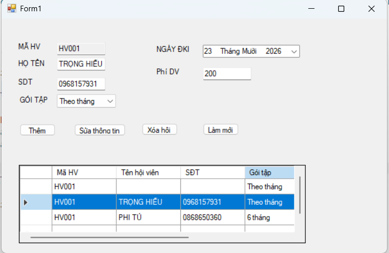
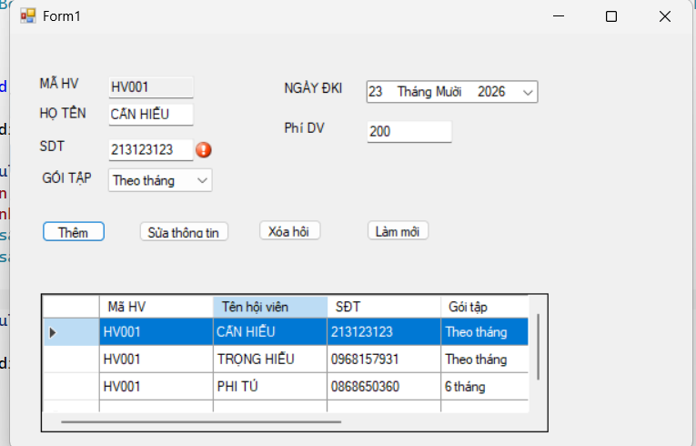
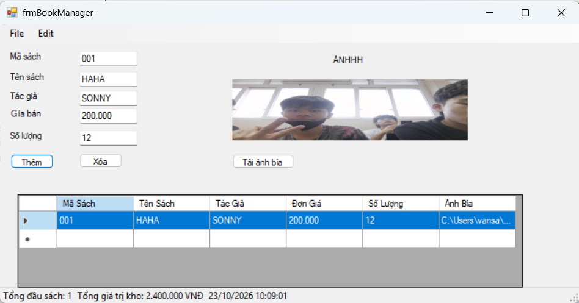
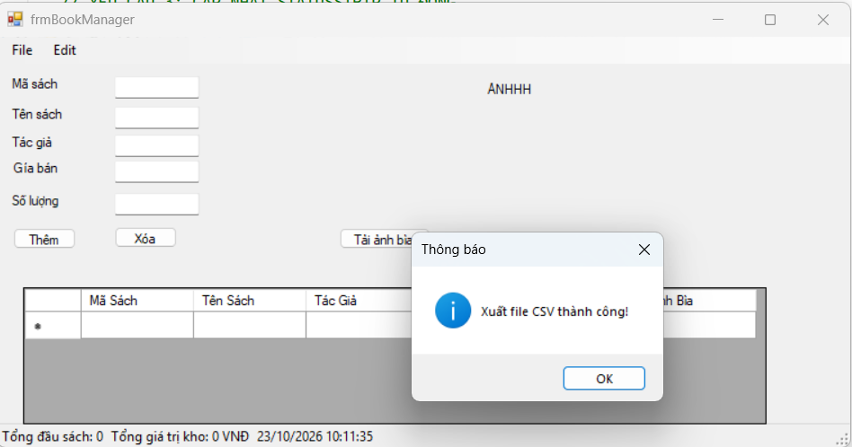
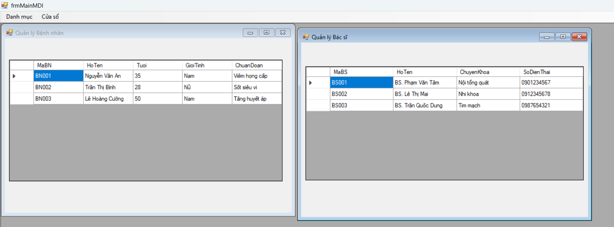
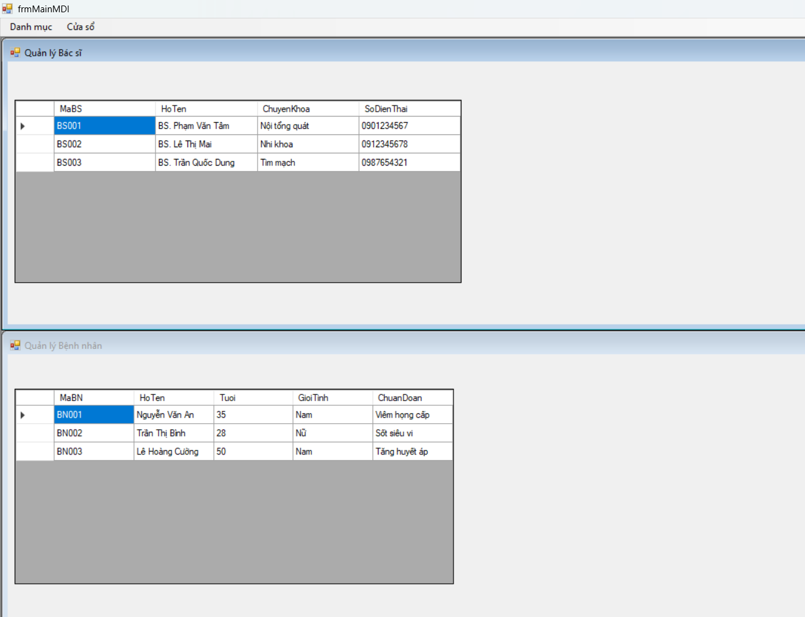
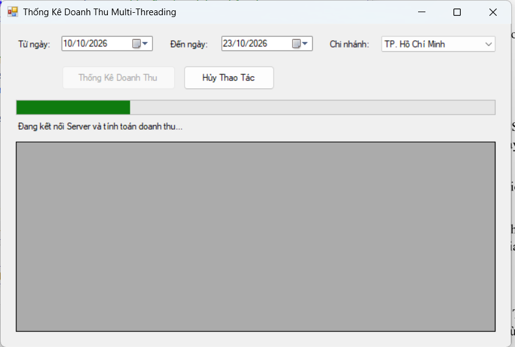
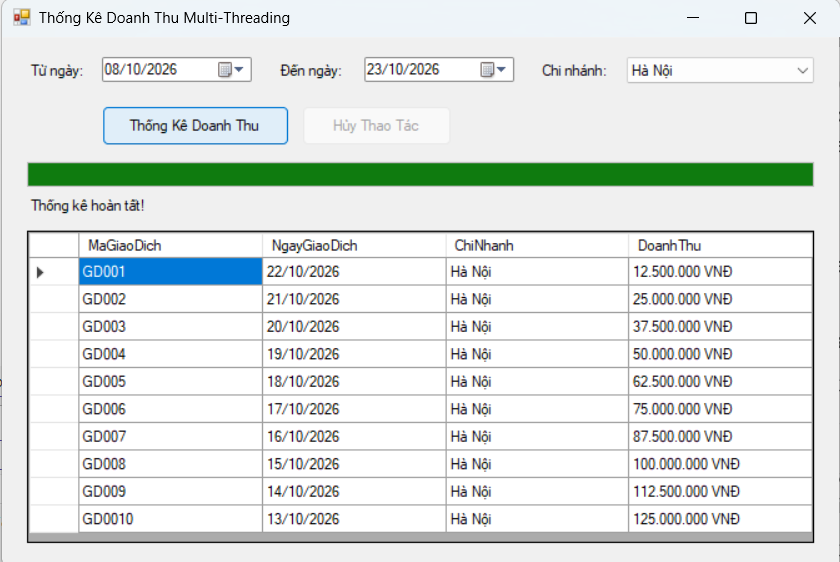
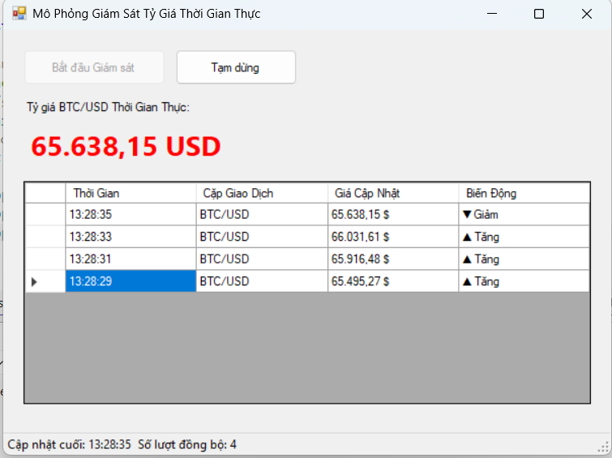

# BÁO CÁO BÀI TẬP THỰC HÀNH LẬP TRÌNH C# WINFORMS

## I. THÔNG TIN SINH VIÊN

* **Họ và tên:** Nguyễn Trọng Hiếu
* **Mã số sinh viên:** 24810320307
* **Lớp học phần:** Lập trình .NET - Mã Lớp: D19QTANM1
* **Link Repository:** https://github.com/heunguyen2k6-collab/BT23TH10.git

---

## II. DANH SÁCH BÀI TẬP HOÀN THÀNH & TỰ ĐÁNH GIÁ

| Bài tập | Tiêu đề bài tập | Trạng thái | Mức độ hoàn thành (%) |
| :---: | :--- | :---: | :---: |
| **Bài 1** | Quản lý Dịch vụ Phòng Gym & Hội viên | Hoàn thành | 100% |
| **Bài 2** | Báo cáo & Lưu trữ Tài liệu Nhà sách | Hoàn thành | 100% |
| **Bài 3** | Hệ thống MDI Quản lý Bệnh viện & Async | Hoàn thành | 100% |
| **Bài 4** | Thống kê Doanh thu Multi-Threading & Cancellation | Hoàn thành | 100% |
| **Bài 5** | Mô phỏng Giám sát Tỷ giá Thời gian thực (Thread-Safety) | Hoàn thành | 100% |

---

## III. MINH HỌA GIAO DIỆN & KỸ THUẬT NỔI BẬT

### 1. Bài 1: Quản lý Dịch vụ Phòng Gym & Hội viên
* **Kỹ thuật áp dụng:** Cấu hình DataGridView bằng code (`AutoGenerateColumns = false`), Data Binding 2 chiều với `BindingSource`, Validation với `ErrorProvider`.
* **Hình ảnh minh họa Giao diện:**

*Mô tả: Giao diện chính hiển thị DataGridView và đồng bộ dữ liệu 2 chiều lên các TextBox.*

*Mô tả: Kiểm tra hợp lệ dữ liệu nhập vào bằng ErrorProvider khi nhấn Thêm mới.*

---

### 2. Bài 2: Quản lý & Xuất Báo cáo Nhà sách
* **Kỹ thuật áp dụng:** `OpenFileDialog` (Tải ảnh bìa), `SaveFileDialog` / `OpenFileDialog` (Đọc/Ghi file CSV), Cập nhật `StatusStrip` theo thời gian thực.
* **Hình ảnh minh họa Giao diện:**

*Mô tả: Chọn ảnh bìa sách từ đĩa cứng hiển thị lên PictureBox và nạp dữ liệu từ file CSV.*

*Mô tả: Xuất và đọc dữ liệu danh sách sách từ file CSV.*

---

### 3. Bài 3: Kiến trúc MDI & Xử lý Bất đồng bộ (Async/Await)
* **Kỹ thuật áp dụng:** MDI Container, Quản lý chống mở trùng Form con, `async/await` chống treo UI, Safe Cross-Thread bằng `this.Invoke()`.
* **Hình ảnh minh họa Giao diện:**

*Mô tả: Khung Form cha MDI điều khiển mở các Form con xếp tầng.*

*Mô tả: Tiến trình ngầm chạy tải dữ liệu nặng 5 giây, giao diện vẫn kéo rê và thao tác bình thường.*

---

### 4. Bài 4: Bảng điều khiển Thống kê Doanh thu Multi-Threading
* **Kỹ thuật áp dụng:** Lập trình bất đồng bộ `async/await`, xử lý tác vụ nặng ở Background Thread bằng `Task.Run()`, quản lý hủy tiến trình ngầm bằng `CancellationTokenSource`, cập nhật tiến độ an toàn Thread-Safety với `this.Invoke()`.
* **Hình ảnh minh họa Giao diện:**

*Mô tả: Tiến trình tổng hợp dữ liệu đang chạy ngầm, ProgressBar tăng dần, giao diện vẫn phản hồi mượt mà không bị treo UI.*

*Mô tả: Tiến trình chạy hoàn tất 100% và nạp danh sách giao dịch chi tiết lên DataGridView.*

---

### 5. Bài 5: Mô phỏng Giám sát Tỷ giá Thời gian thực (Thread-Safety)
* **Kỹ thuật áp dụng:** Vòng lặp giám sát liên tục ở Background Thread (`Task.Run`), tuân thủ quy tắc Thread Safety trong WinForms qua `this.Invoke()` / `Control.InvokeRequired` để tránh ngoại lệ Cross-Thread (`InvalidOperationException`).
* **Hình ảnh minh họa Giao diện:**

*Mô tả: Tỷ giá BTC/USD cập nhật nhảy số thời gian thực (đổi màu Xanh/Đỏ) và ghi nhật ký biến động liên tục vào DataGridView không gây lỗi Cross-Thread.*
